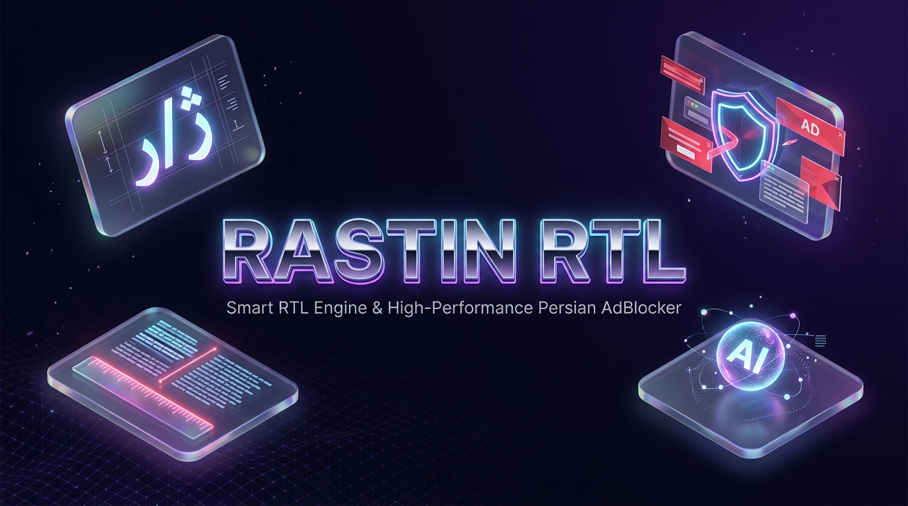
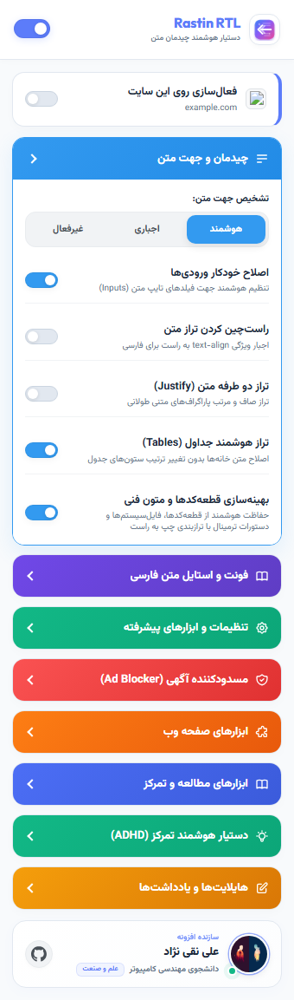
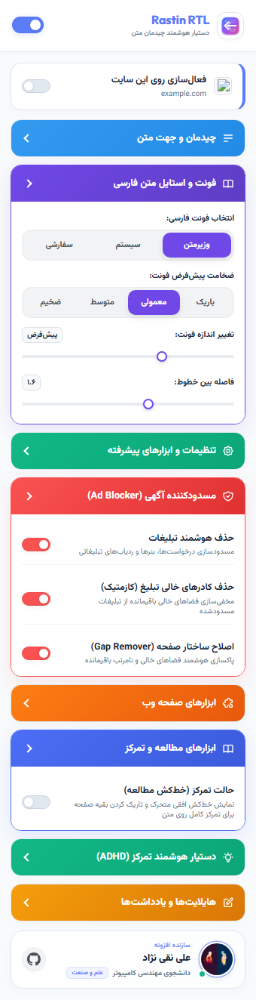

<div align="center">



# Rastin RTL | راستین RTL
### ⚡ The Ultimate Persian RTL Fixer & Iranian/YouTube Ad Blocker for Chrome
**افزونه همه‌کاره اصلاح و زیباسازی متون راست‌به‌چپ (فارسی، عربی)، فونت وزیرمتن، مسدودساز تبلیغات ایرانی و یوتیوب، ابزارهای مطالعه و مترجم هوشمند**

[](manifest.json)
[](ruleset_adblock.json)
[](fonts/)
[](https://github.com/Mancity1383/Rastin-RTL)
[](LICENSE)

[🌟 درباره افزونه](#-درباره-افزونه-about) • [🖼️ تصاویر محیط افزونه](#️-تصاویر-محیط-افزونه-screenshots) • [✨ ویژگی‌ها](#-ویژگی‌ها-و-امکانات-کلیدی) • [🚀 آموزش نصب در کروم](#-آموزش-گام‌به‌گام-نصب-در-گوگل-کروم-chrome-developer-mode) • [⚙️ تنظیمات](#️-راهنمای-تنظیمات-و-استفاده) • [🌐 English Overview](#english-overview)

</div>

---

## 🌟 درباره افزونه (About)

**راستین RTL (Rastin RTL)** یک افزونه متن‌باز، فوق‌العاده سریع و سبک مبتنی بر معماری مدرن **Manifest V3** است که به طور ویژه برای حل ریشه‌ای مشکلات کاربران فارسی‌زبان، عربی‌زبان و وبگردی روزمره توسعه داده شده است.

این افزونه دو نیاز اساسی و بزرگ را همزمان پاسخ می‌دهد:
1. **اصلاح و زیباسازی کامل متون فارسی/عربی (RTL Fixer & Persian Typography):** حل همیشگی به‌هم‌ریختگی متن، معکوس شدن علائم نگارشی، فونت‌های ناخوانای پیش‌فرض سیستم، و به‌هم‌ریختگی قطعه‌کدهای برنامه‌نویسی.
2. **مسدودساز تبلیغات ایرانی و یوتیوب (Advanced Persian & Global Ad Blocker):** با بیش از **۷۸,۰۰۰ قانون فعال در سطح شبکه**، تمامی بنرها، تبلیغات مزاحم شبکه‌های یکتانت، مدیااد، سنجاق، تپسل، صباویژن و همچنین تبلیغات ویدیویی یوتیوب را بدون افت سرعت مرورگر مسدود می‌کند.

---

## 🖼️ تصاویر محیط افزونه (Screenshots)

<div align="center">

| نمای کامل منوی پاپ‌آپ (Full Dashboard) | تنظیمات فونت، مسدودساز و مطالعه (Settings) |
| :---: | :---: |
|  |  |

</div>

---

## ✨ ویژگی‌ها و امکانات کلیدی

### 🎨 ۱. اصلاح تایپوگرافی و جهت متون راست‌چین (RTL Layout & Typography)
- **تشخیص خودکار و هوشمند جهت متون:** اعمال خودکار جهت `rtl` بر روی پاراگراف‌ها، تیترها و ورودی‌ها بدون بهم زدن متون انگلیسی.
- **فونت محبوب و استاندارد وزیرمتن (Vazirmatn):** جایگزینی خودکار فونت‌های تار و زشت با قلم اصیل و خوانای وزیرمتن (همراه با قابلیت تنظیم فونت سفارشی).
- **کنترل دقیق اندازه و خطوط:** لغزنده‌های روان برای تنظیم اندازه فونت (Font Size) و فاصله خطوط (Line Height).
- **محافظت هوشمند از قطعه‌کدها (Tech Code Protection):** نگهداری بلوک‌های برنامه‌نویسی (`<code>` و `<pre>`)، فرمول‌ها و آدرس‌ها به شکل چپ‌به‌راست (LTR) و با فونت Monospace.
- **اصلاح جداول و لیست‌ها:** راست‌چین‌سازی مرتب خانه‌های جدول، سرفصل‌ها و نقل‌قول‌ها.
- **تبدیل اعداد به ارقام فارسی:** سوئیچ اختیاری برای نمایش اعداد با ارقام فارسی در صفحات وب.

---

### 🛡️ ۲. مسدودساز تبلیغات ایرانی و یوتیوب (High-Performance Ad Blocker - MV3)
- **فیلترینگ شبکه مبتنی بر DeclarativeNetRequest:** مسدودسازی بیش از ۷۸,۰۰۰ دامنه و سرور تبلیغاتی بدون مصرف رم اضافی یا تأخیر در لود صفحه.
- **پشتیبانی اختصاصی از تبلیغات وب فارسی:** حذف بنرهای فلش و گیف، پوش نوتیفیکیشن‌ها، و پاپ‌آپ‌های شبکه‌های ایرانی (یکتانت، مدیااد، سنجاق، تپسل و...).
- **مسدودساز پیشرفته تبلیغات یوتیوب (YouTube AdBlocker):** مجهز به رهگیری هوشمند درخواست‌های تبلیغاتی یوتیوب و لغو خودکار پیام‌های ضد ادبلاکر.
- **پاکسازی فضاهای خالی (Gap Remover & Cosmetic Hiding):** از بین بردن کادرهای سفید و فضاهای خالی باقی‌مانده از بنرهای مسدودشده.

---

### 📖 ۳. ابزارهای پیشرفته مطالعه و تمرکز (Reading Suite)
- **خط‌کش مطالعه (Reading Ruler):** نوار افقی شفاف هدایت‌کننده دید برای ردیابی خط به خط متن با موس.
- **حالت تمرکز (Focus Mode):** تاریک کردن ملایم بقیه صفحه به جز خط جاری جهت کاهش حواس‌پرتی در مقالات طولانی.
- **مربی سرعت و تمرکز (Focus Coach):** شبیه‌سازی حرکت روان و هدایت چشم به جلو برای افزایش سرعت خواندن.
- **مطالعه بیونیک (Bionic Reading):** برجسته‌سازی هوشمند حروف اول کلمات برای تسریع انتقال مفهوم به مغز.
- **نوار پیشرفت مطالعه (Reading Progress Bar):** نمایش خط پیشرفت مطالعه در بالای مرورگر.
- **قفل‌شکن کپی و کلیک‌راست (Allow Copy Unlocker):** رفع محدودیت جلوگیری از انتخاب متن، کلیک‌راست و کپی کردن در وب‌سایت‌های قفل‌دار.

---

### 🌐 ۴. مترجم شناور و هوشمند هوش مصنوعی (AI & Dictionary Translator)
- پنجره ترجمه فوری و شناور هنگام انتخاب هر کلمه یا جمله در متن.
- جستجوی سریع در فرهنگ واژگان فارسی **آبادیس (Abadis)** همراه با فونتیک و معنی دقیق.
- ترجمه چندزبانه هوشمند با موتورهای **هوش مصنوعی (AI)** به صورت رایگان و بدون نیاز به کلید اختصاصی.

---

### 📝 ۵. ابزار هایلایت و یادداشت‌برداری (Highlights & Notes)
- هایلایت کردن متون صفحات با رنگ‌های مختلف و نوشتن یادداشت روی هر بخش.
- ذخیره پایدار در حافظه محلی مرورگر (Local Storage) بدون نیاز به سرور.
- جستجوی سریع میان یادداشت‌ها و خروجی در قالب **JSON** یا **PDF چاپی**.
- دکمه اختصاصی پاکسازی کلی یادداشت‌ها در صورت تمایل.

### 🎨 ۶. نوشتن و نقاشی روی صفحات وب (Page Paint)
- از بخش «نوشتن و نقاشی روی صفحه» در پاپ‌آپ، ابزار را باز کنید؛ فعال‌بودن سراسری افزونه کافی است.
- قلم آزاد، هایلایتر، متن چندخطی فارسی و انگلیسی، خط، فلش، مستطیل و بیضی؛ با رنگ، ضخامت، شفافیت، اندازه متن و شکل توپر.
- انتخاب و جابه‌جایی اشیاء، تغییر اندازه با دستگیره‌های گوشه، کپی، حذف شیء و پاک‌کنِ کل شیء. دوبار کلیک روی متن در حالت انتخاب برای ویرایش آن.
- بازگشت با `Ctrl+Z`، تکرار با `Ctrl+Shift+Z` یا `Ctrl+Y` و کپی شیء با `Ctrl+D`؛ با پشتیبانی از چیدمان کیبورد فارسی و کلید `⌘` در مک. ثبت متن با `Ctrl+Enter`، لغو متن با `Esc` و نگه‌داشتن `Shift` برای مربع/دایره یا زاویه‌های ثابت.
- ذخیره خودکار محلی برای هر آدرس، شامل پارامترهای URL و مسیرهای hash در برنامه‌های تک‌صفحه‌ای. طرح هنگام اسکرول در مختصات صفحه باقی می‌ماند و پس از بازکردن دوباره ابزار بازیابی می‌شود.
- نوار ابزار مینیمال با آیکون‌های یکدست، منوی رنگ و ظاهر، رنگ‌ها و ضخامت‌های آماده و منوی خروجی. نوار قابل جابه‌جایی و جمع‌شدن است و با عرض صفحه سازگار می‌شود. «تعامل با صفحه» یا `B`، کلیک و کار با سایت را آزاد می‌کند؛ `Esc` ابتدا منو را می‌بندد یا انتخاب را لغو می‌کند و سپس به حالت تعامل می‌رود.
- خروجی `PNG` و `SVG` از طرحِ بخش قابل‌دید با زمینه شفاف؛ خروجی `JSON` از کل طرح و ورود دوباره فایل JSON. خروجی تصویر شامل عکسِ محتوای سایت نیست.
- طرح به مختصات صفحه متصل است؛ تغییر چیدمان سایت یا عرض پنجره ممکن است محل آن نسبت به محتوای سایت را تغییر دهد. صفحات داخلی مرورگر و صفحات محافظت‌شده اجازه اجرای ابزار را نمی‌دهند.
- سقف هر طرح: ۱۰۰۰ شیء و ۳ مگابایت. وضعیت ذخیره در پایین ابزار نشان داده می‌شود؛ در صورت خطا می‌توانید دوباره تلاش کنید یا طرح را با JSON نگه دارید.

---

## ⚡ روش اول: راه‌اندازی سریع با کد تک‌خطی (اسکریپت هوشمند)

اگر می‌خواهید همه فایل‌ها خودکار دانلود و آماده شوند و نیاز به دانلود دستی و استخراج فایل فشرده نداشته باشید، از یکی از دو دستور تک‌خطی زیر استفاده کنید:

### گزینه الف: با دستور `npx` (در صورت نصب بودن Node.js)
```bash
npx rastin-rtl
```
*(یا نام جایگزین: `npx antigravity-rtl` | قبل از انتشار در npm: `npx github:Mancity1383/Rastin-RTL`)*

### گزینه ب: مستقیم با PowerShell ویندوز (بدون نیاز به هیچ پیش‌نیاز)
کلید `Win + X` را زده، **PowerShell** یا **Terminal** را باز کنید و کد زیر را اینتر کنید:

```powershell
irm https://raw.githubusercontent.com/Mancity1383/Rastin-RTL/main/install.ps1 | iex
```

> **🤖 این اسکریپت خودکار چه کارهایی انجام می‌دهد؟**
> 1. آخرین نسخه پایدار را دانلود و در مسیر امن سیستم (`%LOCALAPPDATA%\Rastin-RTL`) ذخیره می‌کند.
> 2. مسیر پوشه افزونه را بلافاصله در **کلیپ‌بورد سیستم (Clipboard)** کپی می‌کند.
> 3. پوشه را در ویندوز و مرورگر شما را مستقیماً در صفحه `chrome://extensions` باز می‌کند.
> 4. فقط کافیست کلید **Developer mode** را روشن کنید، **Load unpacked** را زده و **Ctrl + V** کنید تا افزونه **برای همیشه روی اکانت کروم شما ذخیره شود**!

*(اگر سورس پروژه را از قبل در سیستم دارید، اجرای `node ./bin/cli.js` یا `.\install.ps1` داخل پوشه پروژه همین عملیات را انجام می‌دهد).*

---

## 🛠️ روش دوم: نصب ساده و دائمی با Developer Mode (بدون نیاز به کد)

اگر نمی‌خواهید از خط فرمان استفاده کنید، این روش ساده‌ترین و استانداردترین راه رسمی کروم برای نصب دائمی افزونه است:

```
[گام ۱: دانلود فایل زیپ] ➔ [گام ۲: صفحه Extensions] ➔ [گام ۳: روشن کردن Developer mode] ➔ [گام ۴: Load unpacked]
```

### 📥 گام اول: دانلود فایل افزونه
۱. روی لینک روبرو کلیک کنید تا سورس دانلود شود: [**دانلود مستقیم فایل فشرده (ZIP)**](https://github.com/Mancity1383/Rastin-RTL/archive/refs/heads/main.zip)  
*(یا اگر گیت دارید: `git clone https://github.com/Mancity1383/Rastin-RTL.git`)*  
۲. روی فایل دانلود شده راست‌کلیک کرده و گزینه **Extract All (استخراج فایل)** را بزنید تا از حالت فشرده خارج شود.

---

### 🌐 گام دوم: باز کردن صفحه مدیریت افزونه‌ها
مرورگر کروم (یا Brave، Edge، Opera) را باز کنید و در نوار آدرس بالا بنویسید:
```text
chrome://extensions
```
*(یا روی منوی سه نقطه بالای مرورگر کلیک کرده و به مسیر `Extensions > Manage Extensions` بروید).*

---

### 🔘 گام سوم: فعال‌سازی Developer Mode
در گوشه بالا سمت راست صفحه افزونه‌ها، دکمه سوئیچ **Developer mode (حالت برنامه‌نویس)** را روشن (ON) کنید.

---

### 📂 گام چهارم: بارگذاری افزونه روی اکانت کروم
- **روش خیلی سریع:** کافیست پوشه استخراج شده افزونه را با ماوس بگیرید و داخل همین صفحه مرورگر **بکشید و رها کنید (Drag & Drop)**!
- **یا روش دکمه:** در نوار بالای صفحه، روی دکمه **Load unpacked (بارگیری بازنشده)** کلیک کنید و پوشه افزونه (پوشه‌ای که فایل `manifest.json` درون آن است) را انتخاب کرده و دکمه **Select Folder** را بزنید.

---

### 📌 گام پنجم: پین کردن آیکون و استفاده دائمی
افزونه **راستین RTL** اکنون به صورت رسمی و دائمی روی پروفایل و اکانت کروم شما ذخیره شد!
روی آیکون پازل 🧩 در نوار بالای کروم کلیک کنید و سنجاق (Pin) کنار **راستین RTL** را بزنید تا دسترسی همیشگی داشته باشید.

> [!TIP]
> **ماندگاری همیشگی:** در این روش، افزونه به پروفایل کاربری کروم شما متصل می‌شود. حتی اگر مرورگر را ببندید یا کامپیوتر را ریستارت کنید، همیشه فعال خواهد ماند و نیازی به هیچ تکراری ندارد.

---

## ⚙️ راهنمای تنظیمات و استفاده

| کلید / سوئیچ | حالت پیش‌فرض | عملکرد |
| :--- | :---: | :--- |
| **سوئیچ سراسری (Master Switch)** | روشن | فعال/غیرفعال‌سازی کلی افزونه در مرورگر |
| **فعال‌سازی روی این سایت** | روشن | ذخیره وضعیت فعال بودن به ازای هر دامنه به صورت مجزا |
| **چیدمان متن (RTL)** | هوشمند | تشخیص خودکار راست‌چینی بر اساس زبان محتوا |
| **فونت فارسی** | وزیرمتن | اعمال قلم خوانا و یکدست روی کل صفحه |
| **مسدودکننده تبلیغات** | روشن | مسدودسازی بنرها و پاپ‌آپ‌های وب‌سایت‌های ایرانی |
| **حذف تبلیغات یوتیوب** | روشن | مسدودسازی تبلیغات ویدئویی و اسپانسر شده در یوتیوب |
| **قفل‌شکن کپی** | اختیاری | فعال‌سازی کپی در سایت‌هایی که کلیک‌راست را بسته‌اند |
| **خط‌کش مطالعه** | اختیاری | نوار متحرک هدایت‌کننده چشم با اسکرول موس |

---

## 🛠️ ساختار فنی پروژه (Architecture)

```text
├── manifest.json                  # پیکربندی رسمی Manifest V3 کروم
├── background.js                  # سرویس‌ورکر پس‌زمینه و هماهنگ‌کننده قوانین DNR
├── ruleset_adblock.json           # ۷۸,۸۱۰ قانون مسدودسازی شبکه (declarativeNetRequest)
├── cosmetic_rules.json            # سلکتورهای مخفی‌سازی بنرهای تبلیغاتی
├── assets/                        # تصاویر، بنر و اسکرین‌شات‌های مستندات
│   ├── banner.png                 # بنر گرافیکی اصلی پروژه
│   ├── popup-ui.png               # اسکرین‌شات کامل رابط کاربری
│   └── features-preview.png       # اسکرین‌شات تنظیمات مسدودساز و فونت
├── content/                       # اسکریپت‌های Content Scripts
│   ├── main.js                    # هسته اعمال استایل و ناظر DOM (MutationObserver)
│   ├── styles.js                  # موتور استایل‌های پویا و فونت‌ها
│   ├── adblock_agent.js           # رهگیری تبلیغات و فیلترینگ کازمتیک
│   ├── youtube_ad_interceptor.js  # سیستم مسدودساز تبلیغات یوتیوب (MAIN World)
│   ├── ruler.js                   # خط‌کش مطالعه و حالت تمرکز
│   ├── copy_unlocker.js           # رفع قفل راست‌کلیک و انتخاب متن
│   └── translator.js              # موتور مترجم شناور با هوش مصنوعی و آبادیس
├── popup/                         # رابط کاربری منوی افزونه (HTML5, CSS3, ES6)
├── fonts/                         # وب‌فونت‌های آفلاین و محلی (Vazirmatn, Outfit)
├── tests/                         # تست‌های خودکار End-to-End با Playwright
└── src/                           # بنچمارک تست و سناریوهای تستی با React 19 + Vite
```

---

## 🧪 توسعه و تست‌ها (Development)

```bash
# ۱. نصب پکیج‌ها
npm install

# ۲. اجرای محیط تستی React با Vite
npm run dev

# ۳. اجرای تست‌های خودکار Playwright
npm test

# ۴. بررسی کیفیت کد و لینتینگ
npm run lint
```

---

## 🔒 امنیت و حریم خصوصی (Privacy First)

- 🛡️ **۱۰۰٪ لوکال و آفلاین:** تمام قابلیت‌ها روی دستگاه خود کاربر اجرا می‌شوند.
- 🚫 **بدون هیچ‌گونه ردیابی، آنالیتیکس یا ارسال داده:** هیچ دیتایی به هیچ سروری ارسال نمی‌شود.
- 🔑 **کلیدهای اختیاری:** نیازی به هیچ اکانت یا کلید نیست و تمام داده‌ها در Local Storage مرورگر شما باقی می‌مانند.

---

## <a name="english-overview"></a>🌐 English Overview

**Rastin RTL** is an all-in-one Chrome extension engineered for Right-to-Left (RTL) typography, ad blocking, and enhanced reading.

### Why Rastin RTL?
- **Flawless RTL Layout:** Automatically detects and aligns Persian, Arabic, and Hebrew text with embedded **Vazirmatn** font.
- **Code Block Protection:** Safely keeps programming snippets (`<code>`, `<pre>`), formulas, and URLs in LTR monospace format.
- **Manifest V3 Ad Blocker:** Powered by over 78,000 declarativeNetRequest rules targeting Iranian ad networks (Yektanet, MediaAd, Sanjagh) and YouTube video ads.
- **Reading & Focus Suite:** Includes Reading Ruler, Focus Mode, Bionic Reading, Reading Progress Bar, and Copy-Unlocker.
- **Smart Translation:** Fast dictionary lookup via Abadis and in-place AI translation.

### Quick Install (Developer Mode):
1. Clone or download this repo.
2. Go to `chrome://extensions/` in Chrome/Brave/Edge.
3. Turn on **Developer mode**.
4. Click **Load unpacked** and choose this folder.

---

## 🏷️ کلمات کلیدی و تگ‌ها (SEO & Search Tags)

`rtl` • `adblocker` • `adblock` • `chrome-extension` • `persian` • `arabic` • `hebrew` • `vazirmatn` • `youtube-adblocker` • `manifest-v3` • `persian-adblocker` • `bionic-reading` • `reading-mode` • `copy-unlocker` • `translator` • `yektanet-blocker` • `iranian-adblocker` • `declarative-net-request`

**عبارت‌های جستجوی محبوب گوگل و گیت‌هاب:**
افزونه راست‌چین کروم | بهترین اد بلاکر فارسی | افزونه مسدودساز تبلیغات یکتانت | حذف تبلیغات یوتیوب در کامپیوتر | افزونه فونت وزیر برای مرورگر | دانلود اکستنشن کروم ادبلاکر | افزونه حل مشکل کپی متن و راست‌کلیک | Persian RTL Chrome Extension | Best Persian Ad Blocker | YouTube Ad Blocker Manifest V3

---

## 👤 سازنده و حقوق نشر (Author & License)

- **طراح و توسعه‌دهنده:** [علی نقی نژاد (Ali Naghinezhad)](https://github.com/Mancity1383)
- **پروانه انتشار:** تحت مجوز متن‌باز [MIT License](LICENSE) — کاملاً آزاد برای همگان.


